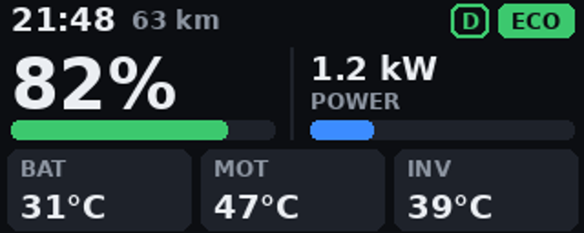
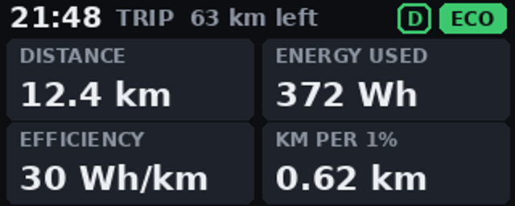
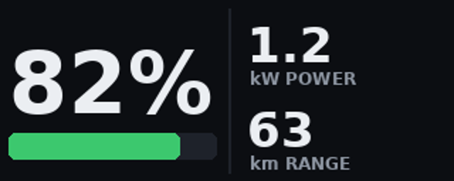

# GESITS display

<picture>
  <source media="(prefers-color-scheme: dark)" srcset="docs/img/cakra_dark.png">
  
</picture>

A **CAKRA Labs** project (Universitas Pertamina) · [cakra-labs.id](https://cakra-labs.id/)

Tools for talking to the **Gesits G1** electric motorcycle's MID (dashboard) over Bluetooth:
read live data, set the clock, and put your own text and pictures on the stock MID screen.

* **Protocol write-up:** [docs/PROTOCOL.md](docs/PROTOCOL.md). It is plain-text `AT+...` commands over
  Bluetooth Classic SPP (or BLE characteristic FFF2). Recovered from the official Gesits app and the
  community GESITS Dashboard app; the latter's notes record what was verified on real bikes.
* **Python toolkit:** `gesits/`. Runs on a laptop or a Raspberry Pi, so a Pi with a screen can
  serve as a replacement display.
* **Custom MID screen:** your own dashboard (charge, power/regen, range, temperatures, mode, errors)
  drawn as a picture and pushed into the MID's map area.
  * From a laptop/Pi: `python -m gesits screen ble://GESITS` (or `bt://…`)
  * Standalone on the bike: [firmware/esp32_mid_screen](firmware/esp32_mid_screen) (ESP32 over BLE)

  Three pages, 320×128 (the MID's map area). By default: **big** while riding, **details** and **trip** when stopped.

    

* **Simulator:** a fake bike, so you can develop without the motorcycle.

> Most commands are used daily by the community GESITS Dashboard app, but this toolkit itself has
> not been run on a bike yet. Test while parked. Don't fiddle with the MID while riding.
> The odometer-write command (`AT+ODO=`) is documented but deliberately not exposed.

> **Testing with a laptop?** Follow [docs/LAPTOP_TEST.md](docs/LAPTOP_TEST.md) (about 15 minutes, read-only first).

## Quick start

Needs Python 3.9+. Pillow is required for pictures (`pip install pillow`) and pyserial for
`serial://` (`pip install pyserial`).

```bash
# 1. Pair the bike: ignition ON, press the Bluetooth button on the left handlebar,
#    then pair from your computer. Note its MAC address.

# 2. Live data (Linux / Raspberry Pi / Windows):
python -m gesits monitor bt://AA:BB:CC:DD:EE:FF            # channel 1 by default
python -m gesits monitor bt://AA:BB:CC:DD:EE:FF/2 --screen diag
python -m gesits monitor serial://COM5                     # Windows Bluetooth COM port
python -m gesits monitor serial:///dev/rfcomm0             # after `sudo rfcomm bind 0 <MAC> 1`
python -m gesits monitor ble://GESITS                      # Bluetooth LE (pip install bleak)

# 3. Write to the MID
python -m gesits time  bt://AA:BB:CC:DD:EE:FF                     # set the MID clock
python -m gesits text  bt://AA:BB:CC:DD:EE:FF "Halo Gesits"        # 20-char text line
python -m gesits range bt://AA:BB:CC:DD:EE:FF 57.5                 # range figure (km)
python -m gesits image bt://AA:BB:CC:DD:EE:FF logo.png --preview sent.jpg   # picture

# 4. Custom MID screen (live data drawn as a picture every 3 s)
python -m gesits screen --preview screen.png                     # offline preview, sample data
python -m gesits screen ble://GESITS                              # over Bluetooth LE (pip install bleak)
python -m gesits screen bt://AA:BB:CC:DD:EE:FF                    # over Bluetooth Classic

# 5. Explore: send any command, see the raw reply
python -m gesits raw bt://AA:BB:CC:DD:EE:FF "AT+SPD?"

# Offline: see exactly what JPEG would be sent (350x220, <= 7000 base64 chars)
python -m gesits encode logo.png --preview preview.jpg
```

### Without the bike

```bash
python -m gesits sim --preview-dir frames/      # terminal 1
python -m gesits monitor tcp://127.0.0.1:3333   # terminal 2
python -m gesits image tcp://127.0.0.1:3333 logo.png   # frame saved to frames/
```

### Tests

```bash
python -m unittest -v
```

## Drawing for the MID

Pictures are sent as JPEG, cropped to fill **350 × 220** by default (MID max width 350, max height
about 500). The base64 text must stay **≤ 7000 characters**, so quality drops automatically for busy
pictures. Simple, high-contrast graphics look best. `--legacy` uses the old official app's 164 × 88,
4-colour format instead.

## Repositories

* Public: https://github.com/mzalmuzakki/GESITS_MID_pub (`main`). GitHub Actions builds the Android APK
  here and publishes it on the **android-latest** release.
* Private copy: `mzalmuzakki/GESITS_display`. Kept in sync by `.github/workflows/sync-private.yml`
  once the `PRIVATE_REPO_TOKEN` secret is set in the public repo.

## Roadmap

1. ✅ Protocol recovered from the app, plus Python toolkit and simulator
2. ✅ Cross-checked with GESITS Dashboard (real-bike behaviour, JPEG pictures, 20-char text, BLE path)
3. ✅ Custom MID screen (`gesits screen`) and BLE connection (`ble://`), ESP32 firmware (not yet compiled)
4. ⏳ First test on your bike: BLE connect, custom screen, then ESP32 build
5. Android/web dashboard (phone or tablet as the MID)
6. ESP32 + TFT replacement display (ESP32 classic, since it needs Bluetooth Classic SPP)
7. Stock MID firmware / wiring work (needs hands-on hardware access)
